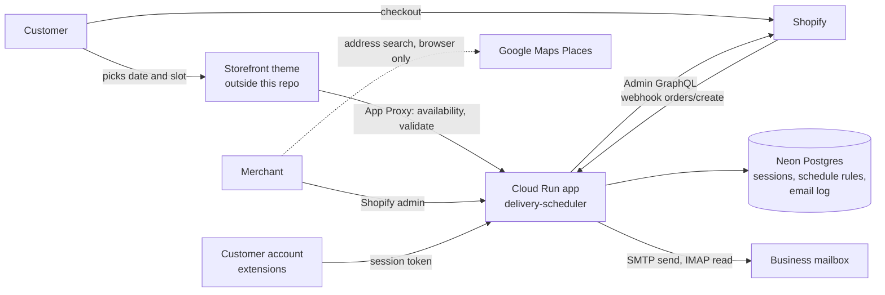

# Architecture

How the delivery-scheduler app works. Read this first, then [runbook.md](runbook.md) to operate it and [gcp-inventory.md](gcp-inventory.md) for the cloud resources.

## What it is
A Shopify embedded app for one merchant, The Flowercart (Metro Manila). It does three jobs:

1. **Delivery scheduling.** Customers pick a delivery date and time slot. The app holds the rules (cutoff hour, preparation time, booking window, time slots, blocked dates, optional capacity per slot) and tells the storefront which dates and slots can be booked.
2. **Order operations.** A workspace in the Shopify admin (`/app/orders`) where the merchant sees orders by delivery day, reschedules, tags, fulfils, cancels, edits the shipping address and emails customers.
3. **Checkout helpers.** Delivery information on the thank-you page, the order status page, the customer account and the admin order page.

It is built on React Router 7, the Shopify app toolkit (`@shopify/shopify-app-react-router`), Polaris web components (Polaris 2.0), Prisma and Postgres, and runs on Google Cloud Run. The Polaris script is loaded from a URL kept in `app/lib/polaris-url.ts`, not from an npm package.

## The main idea
**The Shopify order is the source of truth.** The app writes the delivery information onto the order itself and reads it back from there. The database only holds three things: Shopify sessions, the schedule rules, and a log of emails sent.



### How delivery information is stored on an order
| Where | Name | Meaning |
|---|---|---|
| Checkout attribute | `Delivery Date`, `Delivery Time` | what the customer chose at checkout |
| Metafield | `custom.date`, `custom.time_slot` | canonical delivery date and slot, read by everything else |
| Metafield | `delivery.date`, `delivery.time_slot`, `sidekick.delivery_date` | mirrors of the canonical values, kept in sync on every write |
| Metafield | `delivery.sync_status` | `ok` or `attention:<code>` from validation at checkout time |
| Metafield | `$app.reschedule_status`, `$app.reschedule_requested_at`, `delivery.reschedule_history` | reschedule state and history |
| Metafield | `$app.reschedule_seen_at`, `$app.email_reply_seen_at` | what the merchant has already acknowledged |
| Tag | bare date `2026-10-03` and bare slot `9AM-12PM` | used by the Orders page tabs, search and the merchant's own automations |
| Tag | `resched` | one self-service reschedule is allowed; this tag closes it |
| Tag | event tags `resched-<date>`, `addr-<date>`, `tracked-<date>` | a timeline of what happened (rescheduled, address edited, fulfilled with tracking), dated by the shop-local day |

Tags are capped at 40 characters by Shopify. `app/lib/order-tags.ts` owns the whole tag vocabulary.

## Flows

### 1. A new order arrives
`routes/webhooks.orders.create.ts` receives Shopify's `orders/create` webhook (HMAC verified).
1. Reads `Delivery Date` and `Delivery Time` from the order attributes. An order without them is acknowledged and skipped.
2. `services/order-delivery-sync.server.ts` loads the schedule rules and evaluates the choice against the moment the customer checked out (`delivery.sync_status`). Capacity is advisory: an over-capacity order is still accepted and flagged `attention:capacity`.
3. Writes the metafields and replaces the schedule tags.
4. If any step fails the handler answers `500`, so Shopify redelivers. Every step is idempotent, so a retry only fills in what is missing.

### 2. The storefront asks what can be booked
The theme's date picker calls the **app proxy** (`/apps/schedule-rules`), which Shopify forwards to this app with a signed query string.
- `GET /apps/schedule-rules` returns the availability window: for each upcoming date and slot, whether it is bookable, plus the cutoff time.
- `/apps/schedule-rules/validate` checks one date and slot.
- `/apps/schedule-rules/coverage?q=` powers the delivery fee checker block (area lookup against `app/data/ncr-zipcodes.ts`).
- `/apps/schedule-rules/products` pages through a collection with the Storefront API.
The picker itself is part of the merchant's theme and is not in this repository.

### 3. A customer reschedules
Two entry points write the same result:
- the customer account extension `delivery-reschedule-customer`, through `routes/public.customer-account.reschedule.ts`;
- the storefront, through the app proxy route `apps.schedule-rules.reschedule.ts` (the customer is identified by the `logged_in_customer_id` that Shopify adds to the signed proxy request).
Both verify the customer owns the order and that it is still reschedulable (not fulfilled, `resched` tag absent), validate the new date and slot against the rules, then write the metafields, tags and history. `services/reschedule-order-delivery.server.ts` is the single write sequence shared by the customer account route and the merchant reschedule.

### 4. The merchant works the day
`/app/orders` (`routes/app.orders.tsx`).
- **Loader:** queries orders from Shopify (tab, delivery-date tag, search, sort, cursor paging), works out the shop-local "today", and fetches recent reschedules for the banner. The time-slot filter runs in the browser.
- **Action:** one POST endpoint, dispatched on the `_action` field: `sendEmail`, `markRescheduleSeen`, `markEmailReplySeen`, `editDetails`, and the bulk actions `archive`, `unarchive`, `cancel`, `tagsAdd`, `tagsRemove`, `markFulfilled`, `markAsPaid`, `reschedule` (`services/bulk-actions.server.ts`, at most 10 orders, run inside the request).
- **Screen:** `OrdersIndexTable` (list), `OrderDetailsPanel` (one order with a timeline), and a modal per action. The page refreshes itself (`hooks/useSmartRefresh.ts`) but pauses while a modal is open.
- The notifications bell lists unseen customer replies (`/app/orders/inbox`) and recent customer reschedules.

### 5. The merchant edits the rules
`/app/scheduler` (`routes/app.scheduler.tsx`) is the only place the schedule rules are changed. Each change is a small operation (`save settings`, `create slot`, `delete slot`, `save day override`, ...) handled by `services/scheduler-ops.server.ts`. Every write carries the version the page loaded; if someone else saved first the server answers `stale_config` and the page reloads. Booked counts come from `services/delivery-bookings.server.ts`, which reads Shopify orders by `custom.date` and caches the result briefly in memory.

### 6. Email
- **Send:** `services/send-customer-email.server.ts` (nodemailer over SMTP) sends from the business mailbox, adds a copy to the sender, supports up to 3 photos, and logs a row in `EmailSendLog` for the order timeline.
- **Read:** `services/customer-inbox.server.ts` (imapflow) opens the same mailbox read-only during a request (Orders page load, Refresh, bell, order panel). There is no background connection. Replies are matched to orders by the order number in the subject and the customer address.
- **State:** unseen/seen markers live in order metafields and the quick replies in a shop metafield (`$app.quick_replies`), so nothing about email is stored in Postgres except the send log.

## The scheduling rules
`app/lib/delivery-availability.ts` is the rules engine, used by the server and the extensions.
- **Rules:** timezone, same-day cutoff hour, preparation hours, booking window in days, the list of slots (`display` and a frozen `value` such as `9AM-12PM`), blocked dates, blocked slots per date, and optional capacity per date and slot.
- **A slot is bookable** when the date is inside the window, not blocked, after the cutoff and preparation time, and (for capacity) not full.
- `lib/schedule-rules-schema.ts` validates writes strictly and reads stored rules leniently, reporting any repair as a health issue.
- `lib/slot-value.ts` decides that `9am - 12pm` and `9AM-12PM` are the same slot; nothing rewrites a stored slot value.
- Defaults (used until a row exists): Asia/Manila, 5 PM cutoff, 1 hour preparation, 25 days, four slots (9AM-12PM, 12PM-3PM, 3PM-6PM, 6PM-11PM).

## Trust boundaries
| Caller | Routes | How it is verified |
|---|---|---|
| Merchant in the Shopify admin | `app.*`, `auth.*` | Shopify session token (`authenticate.admin`) |
| Shopify webhooks | `webhooks.*` | webhook HMAC (`authenticate.webhook`) |
| Storefront through the app proxy | `apps.schedule-rules.*` | app proxy signature (`authenticate.public.appProxy`, `lib/verify-app-proxy.server.ts`) |
| Customer account extensions | `public.customer-account.*` | customer session token checked with `jose` and the app secret, then `unauthenticated.admin`; CORS limited to Shopify's extension origin |
No endpoint relies on a secret of its own. Customer email addresses are always read from Shopify, never from a request.

## Data model
`prisma/schema.prisma`:
- `Session`: Shopify OAuth sessions and tokens.
- `DeliveryScheduleConfig`: one row per shop with the rules (slots, blocked dates and capacity stored as JSON text) and a `version` counter for optimistic locking.
- `EmailSendLog`: one row per email sent (shop, order, recipient, subject, time).
Migrations in `prisma/migrations` run when the container starts (`prisma migrate deploy`).

## Code map
| Path | What lives there |
|---|---|
| `app/routes` | pages, resource routes, app proxy endpoints, webhooks (file-system routing) |
| `app/services` | everything that talks to Shopify, Postgres or the mailbox (`*.server.ts`) |
| `app/lib` | pure logic: rules engine, tag vocabulary, order helpers, email parsing |
| `app/components` | Polaris web components (Polaris 2.0) for the Orders page and the Scheduler page; `ui/` holds the shared modal, banner, checkbox and section header |
| `app/hooks` | refresh, diff, bulk-modal and clipboard hooks |
| `app/data` | the Metro Manila ZIP and barangay list for the fee checker |
| `extensions` | Shopify extensions (below) |
| `prisma` | schema and migrations |
| `test` | unit tests (vitest) |

## Extensions
| Extension | Type | Where it shows | What it does |
|---|---|---|---|
| `delivery-thank-you` | UI | thank-you page | delivery schedule card |
| `delivery-date-editor` | UI | customer order status | shows the delivery date, reads `public/customer-account/order-delivery` |
| `delivery-reschedule-customer` | UI | customer account order action | menu item and modal to reschedule |
| `delivery-reschedule-action` | UI | admin order action | read-only reschedule status |
| `order-delivery-block` | UI | admin order page | delivery date, slot and reschedule status |
| `delivery-fee-checker` | Theme block | storefront | area input that calls `/apps/schedule-rules/coverage` |

## Configuration
Environment variables and secrets are listed in [gcp-inventory.md](gcp-inventory.md). Locally, copy `.env.example`.

## Develop and test
```
npm install
npm run setup          # prisma generate and migrate deploy (needs DIRECT_DATABASE_URL)
npm run dev            # shopify app dev with shopify.app.production.toml
npm test               # unit tests
npm run test:extensions
npm run typecheck && npm run build
```

## Known leftovers
These exist in the code but no longer match how the shop works. They are safe to ignore or remove.
- References to a Messenger agent, Lalamove and `MESSENGER_*` / `LALAMOVE_SHOP` variables (`lib/messenger-conversation.ts`, `services/delivery-coverage.server.ts` wording, the Meta page link on the Orders page).
- Code comments that cite documents that are not in this repository (`docs/api.md`, `docs/scheduler-v2-ux.md`, `customer-email-design.md`) and internal review codes (ADR, REC, DEF, E-).
- The landing page at `/` still has the Shopify template placeholder text, and the toml still declares template demo metaobject and metafield definitions.
